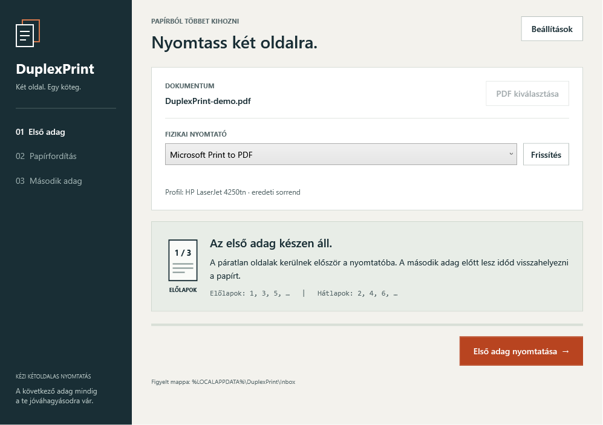
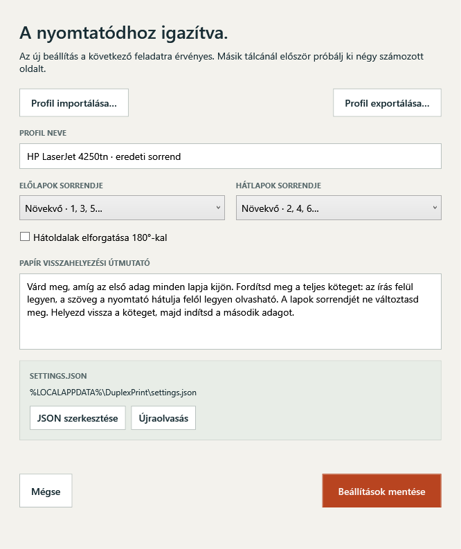

# DuplexPrint

[](https://github.com/madarlevi/DuplexPrint/actions/workflows/build.yml)


**Print the fronts. Reload the stack. Click to print the backs.**

DuplexPrint guides you through manual duplex PDF printing on a Windows printer.
It includes its PDF-processing components and uses the Windows PDF renderer:
**no separate PDF reader is needed**. The interface is Hungarian.



## Two editions

| Edition | Use | Availability |
| --- | --- | --- |
| **Portable ZIP** | Extract, launch, select or drop a PDF, choose your printer | Implemented and locally tested with the .NET Desktop Runtime |
| **Installed MSIX — experimental** | Adds a **DuplexPrint** virtual queue; print from another app to enter the same guided workflow. Manual PDF selection remains available. | Windows 11 24H2+; package/activation validated, installation and end-to-end capture still need supervised testing |

The installed edition uses a Windows-hosted, per-user print background task
and an interactive desktop agent. There is no interactive LocalSystem service,
third-party driver installer, or system-wide PDF application dependency.

**Release status:** local builds, regression tests and framework-dependent
packages are validated. A network-enabled self-contained CI publish, MSIX
publisher signing, real virtual-queue activation/conversion and physical
printer tests remain release checks. See [validation details](docs/REVIEW.md).
A successful build is not proof of perfect physical paper handling.

## Features

- Square-edged WPF interface with distinct document, reload and completion steps.
- Open or drop one PDF, or receive queued PDFs from a watched folder.
- Choose a Windows printer and refresh the list. The app excludes its own
  capture queue to prevent recursive jobs.
- Preserve the original HP LaserJet 4250tn workflow: odd pages ascending,
  then even pages ascending, with an explicit click before **each** batch.
- Handle single-page files and pad an unpaired last front with a blank back.
- Import/export printer profiles; edit `settings.json` or use the settings window.
- Configure front/back order independently, optional 180° back rotation and
  printer-specific reloading instructions.
- Snapshot both passes before printing, keep source PDFs intact, and clean up
  owned temporary files.
- Isolate PDF rendering and printer-driver work in child processes with
  cancellation, timeouts and readable errors.

This is **manual** duplex printing: one simplex copy per pass. It does not enable
hardware duplex automatically. Printer/profile settings are locked once the
first pass starts. Printing is never started merely by opening a file.

## Requirements

- **Portable:** Windows 11 x64, or a Windows 10 LTSC/Enterprise version
  [supported by .NET 10](https://learn.microsoft.com/en-us/dotnet/core/install/windows#supported-versions).
- **Installed virtual printer:** Windows 11 **24H2 / build 26100 or later**, with
  current Windows updates and a trusted, signed MSIX.
- Your physical printer and its working Windows driver.
- The default release publish is **self-contained**, including .NET.
  A filename containing `framework-dependent` instead requires the
  **.NET 10 Desktop Runtime x64**.

No SumatraPDF installation or download is required. Only x64 is prepared.

## Install the portable edition

1. Open [Releases](https://github.com/madarlevi/DuplexPrint/releases) when a build
   is available and download `DuplexPrint-v1.2.0-win-x64.zip` (or a later version).
2. Right-click the ZIP → **Extract All** into a writable folder.
3. Launch **DuplexPrint.exe**. Keep all extracted files together.
4. Select the physical printer and PDF; follow the two printing steps.

```text
DuplexPrint-v1.2.0-win-x64/
  DuplexPrint.exe
  DuplexPrint.PdfWorker.exe
  DuplexPrint.dll
  DuplexPrint.deps.json
  DuplexPrint.runtimeconfig.json
  PdfSharp*.dll, Microsoft*.dll, .NET runtime files, ...
  portable.mode
  settings.json                 # created locally when saving settings
  configuration/
    settings.example.json
    profile.schema.json
    profiles/hp-laserjet-4250tn.json
  LICENSE.txt
  THIRD_PARTY_NOTICES.txt
  licenses/
  assets/screenshots/
  docs/
  README.md
```

The `portable.mode` marker stores settings beside the app. Do not run directly
inside the ZIP or move individual executable files out of the extracted folder.

## Installed edition: virtual printer

The experimental MSIX declares a **DuplexPrint** print queue using Microsoft's
Print Support Virtual Printer API. Windows delivers OpenXPS data to the
packaged background task. Windows converts it to PDF with its print ticket, saves it atomically
to the current user's package inbox, and handed to the WPF app. A captured job
still waits for your approval before sending pages to the physical printer.

For a **trusted signed** package, open the MSIX, choose **Install**, and launch
DuplexPrint from Start. Then select **DuplexPrint** in another application's
Print dialog. Choose the physical HP printer inside DuplexPrint.
Use one copy in the source application's Print dialog; copy/collation behavior
in this experimental capture path still requires validation.

A package named `*-unsigned.msix` is a **development artifact**, not a ready-to-run
public installer. Windows requires valid, trusted package signing. No script
automatically changes certificate trust, enables test signing or installs a queue.
See [installed edition and signing](docs/INSTALLED_EDITION.md) for requirements,
package layout, recovery and the remaining end-to-end test checklist.

The installed agent stays available after its window closes. Launching the app
again brings back its window. Capture activates it on demand; no boot-time
service installation is required. Use Task Manager to end it if necessary.

## Print a document

1. Choose **PDF kiválasztása** or drag a PDF onto the window.
2. Select the physical printer. **Frissítés** refreshes available printers.
3. In **Beállítások**, select/import the correct printer/tray profile if needed.
   The default is **HP LaserJet 4250tn · eredeti sorrend**.
4. Click **Első adag nyomtatása**. For five pages this sends `1, 3, 5`.
5. **Wait until every sheet physically leaves the printer.** Follow the displayed
   reloading instructions. The default preserves the original instruction:
   turn the complete stack with the writing on top, readable from the rear of
   the printer, and keep the sheets in order.
6. After reloading, click **Papír visszahelyezve · Második adag**. For five pages
   this sends `2, 4, blank`. Keep the unpaired sheet in the stack.
7. Check the output, then choose **Bezárás**. A single-page PDF needs no second pass.

The exact tray/feed path on the HP LaserJet 4250tn has not been specified or
physically revalidated in this review. First try four numbered pages; then test
an odd-page document. Do not assume one tray's reloading instructions fit another.

A completed worker confirms **submission**, not that paper has finished printing.
Check the Windows queue and sheets after errors or cancellation before retrying.
Already submitted jobs can survive worker termination. A second-pass retry
resubmits backs only.

### Settings and printer profiles



Use **Beállítások** to change order, rotation and the reloading text. Import/export
uses a small standalone profile JSON file. You can edit the full `settings.json`
with **JSON szerkesztése**, save it, choose **Újraolvasás**, then save settings.

The settings window shows the active path:

| Mode | Settings location |
| --- | --- |
| Portable ZIP | Next to `DuplexPrint.exe` |
| Source/development build | `%LOCALAPPDATA%\DuplexPrint\settings.json` |
| Installed MSIX | `%LOCALAPPDATA%\Packages\<package-family>\LocalState\settings.json` |

The prior settings are retained as `settings.json.bak` when saving. Invalid,
unsupported or oversized JSON loads safe defaults and shows a warning, without
silently overwriting the broken file. Profile files cannot contain commands.
There are no automatic profile downloads.

See [configuration documentation](configuration/README.md) and the included
[HP profile](configuration/profiles/hp-laserjet-4250tn.json). A separate profile
repository starter is prepared locally under `printer-profiles-repo/`; it is
intentionally ignored by this repository and has its own README, MIT license,
schema, contribution guide and validation workflow. Suggested future repository:
`madarlevi/DuplexPrint-Profiles` (not created automatically).

### Quality and paper size

The included native helper renders through **Windows.Data.Pdf at 600 DPI**.
.NET's `PrintDocument` draws the pages using your selected Windows driver.
Rendering is rasterized; it does not retain vector PDF commands.

The app preserves crop/rotation, matches physical page sizes to driver-reported
paper sizes when possible, and otherwise uses the driver's default paper.
It centers pages inside hardware margins, shrinks proportionally when needed,
and never enlarges them automatically. Printer hardware margins prevent a
universal borderless guarantee.

Fine line art, very small text, color-critical work and unusual PDFs require
visual/physical comparison. Pages over 16,384 pixels per side or 512 MiB of raw
pixels at 600 DPI are rejected rather than silently reducing quality. Each pass
is rendered and validated before its first sheet is submitted.

### Watched folder and background mode

The portable/development default inbox is `%LOCALAPPDATA%\DuplexPrint\Inbox`.
New/renamed PDFs are queued, with one document presented at a time:

```powershell
.\DuplexPrint.exe "C:\My Documents\example.pdf"
.\DuplexPrint.exe --watch "C:\My Documents\PDF inbox"
.\DuplexPrint.exe --background --watch "C:\My Documents\PDF inbox"
```

Portable watched folders do not reprint existing files on startup. The installed
capture inbox does recover pending PDFs on startup; after closing a captured job,
its input PDF moves to `LocalState\History\Submitted` or `Cancelled` and is not
automatically offered again. Captured PDFs remain on disk until you delete them;
manual source PDFs are never moved. A crash can leave a pending job, which still
requires confirmation after recovery.

Optional startup registration is for **unpackaged** use only:

```powershell
.\DuplexPrint.exe --register-startup --background
.\DuplexPrint.exe --unregister-startup
```

These change only the current user's `VirtualDuplexPrinter` Run entry.
Unregister before moving the portable folder. The installed edition activates
on demand and does not use this registration.

## Build and test

On Windows x64 install the **.NET 10 SDK**, MSVC x64 C++ tools (Visual Studio
Desktop development with C++, or equivalent Build Tools) and Windows SDK
**10.0.19041.0+**. Installed-edition builds need SDK **10.0.26100.0+**.

```powershell
dotnet restore DuplexPrint.slnx --locked-mode
dotnet build DuplexPrint.slnx -c Debug --no-restore -warnaserror
dotnet build DuplexPrint.slnx -c Release --no-restore -warnaserror
.\tests\DuplexPrint.Tests\bin\Release\net10.0-windows\DuplexPrint.Tests.exe
dotnet run --project DuplexPrint
```

MSBuild compiles the native PDF helper automatically; no developer-machine path
is stored. It uses the release static CRT in both configurations. End users
do not install C++ build tools or a separate VC runtime.

The executable regression harness covers actual PDF rendering, order/blank
geometry, paper fitting, errors, settings validation and UI transitions.
**No real print jobs are submitted.** Workflow-transition tests use an injected
submission function; renderer tests use the real OS PDF engine.

```powershell
./scripts/Build-PdfWorker.ps1 -Component CaptureTask -OutputDirectory ./artifacts/capture-tests
./scripts/Build-PdfWorker.ps1 -Component CaptureTests -OutputDirectory ./artifacts/capture-tests
./artifacts/capture-tests/DuplexPrint.CaptureTests.exe "$PWD/artifacts/capture-tests/DuplexPrint.Capture.dll"
```

The latter validates native activation/lifetime only, not OS-triggered printing.

## Build packages and GitHub Releases

```powershell
./scripts/Package.ps1 -Version 1.2.0
./scripts/Package-Installed.ps1 -Version 1.2.0
```

Both default to self-contained win-x64, without trimming/single-file extraction.
ZIP/MSIX and SHA-256 files go under ignored `artifacts/packages/`.
`-FrameworkDependent` explicitly creates a smaller runtime-dependent build.
The installed package is unsigned unless signing arguments are supplied.

[The Windows workflow](.github/workflows/build.yml) runs restore, Debug/Release
builds, nonprinting tests, portable packaging and unsigned experimental MSIX
validation on branch pushes, pull requests and manual dispatch.

[The release workflow](.github/workflows/release.yml) runs the same checks when
you **push a `vX.Y.Z` tag**, then automatically creates a GitHub **prerelease**
with the packages and checksums. Optional signing uses repository secrets.
A normal branch push does not publish a release. This review did not push tags,
modify a remote repository or trigger a release.

Read [GitHub setup — Hungarian guide](docs/GITHUB_HU.md) for uploading to
`madarlevi/DuplexPrint`, certificate configuration and releasing a tag.

## Troubleshooting

| Problem | Action |
| --- | --- |
| Missing PDF worker | Extract the complete ZIP again; keep both application EXEs together. |
| No printer / printer disappeared | Check the Windows driver and Print Spooler, then choose **Frissítés**. |
| Wrong pairing or upside-down backs | Use the correct tray profile; test four numbered pages and adjust order/180° back rotation. |
| Invalid settings | Fix the JSON or explicitly save defaults in settings; the original file is preserved as a backup. |
| PDF cannot be prepared | Wait for copying to finish. Password-required documents and print restrictions are not bypassed. |
| MSIX will not install | Check Windows 11 24H2+, package signature/trust and publisher identity. An unsigned artifact is not a public installer. |
| Captured job has no window | Open DuplexPrint from Start; inspect package `LocalState\Inbox` and `capture-error.txt`. |
| Timeout or cancelled operation | Inspect the Windows queue and printed sheets before retrying. |
| Runtime missing | Use a self-contained release, or install .NET 10 Desktop Runtime x64 for a framework-dependent package. |

Forced process termination can leave owned `DuplexPrint-*` temporary folders or
capture `.partial` files. Remove only stale files after all associated processes
have stopped. Document contents are not uploaded; no telemetry, automatic PDF
downloads, shell printing or default-viewer fallback is implemented.

## License and review

Original C#, XAML, native helpers and profiles: [MIT](LICENSE),
© 2026 **Madár Levente (madarlevi)**.
[Third-party notices](THIRD_PARTY_NOTICES.md) and `licenses/` apply separately.
PDFsharp is deliberately pinned to **6.2.4**; review version-specific licensing
before upgrading. Windows PDF/print components are OS APIs, not redistributed
third-party PDF binaries. MSVC/toolchain redistribution terms remain applicable.

See the [PDF architecture review](docs/PRINTING_ARCHITECTURE.md),
[installed architecture](docs/INSTALLED_EDITION.md) and
[validation record](docs/REVIEW.md).
